# Melanoma Classification: ResNet-18 Baseline and Siamese Auxiliary-Head Model

## StudentID: 48036261
## Name: Thirumurugan Thirunanthanan (Nandos)

## Feasibility Review: Melanoma Classification

| Project | Proposed model | Difficulty |
|---|---|---|
| ISIC 2020 dermoscopic images | Siamese network | Hard |

### Feasibility decision

This is a feasible research project for prioritising lesions for clinician review. It is not a deployable screening system or autonomous diagnostic tool. I would proceed with the Siamese model and a ResNet-18 baseline, as long as the split is patient-level, the threshold is chosen only on validation data, and the report clearly shows the false-negative burden and referral trade-off.

### User need and scope

The intended users are dermatology clinicians or trained image reviewers who need decision support when assessing dermoscopic lesions. The prototype classifies the supplied images as melanoma or benign and tests whether pairwise representation learning improves triage compared with a standard CNN. A positive or uncertain result should be sent for expert review; a negative result should not be treated as ruling out melanoma.

### Testable acceptance criteria

- Keep all images from each patient in exactly one split; verify that the 70/15/15 train, validation and test partitions have no patient overlap.
- Train and compare the Siamese model and ResNet-18 baseline on the same partitions; report AP, AUROC, accuracy, macro-F1, per-class precision and recall.
- Select the operating threshold using validation data only, targeting at least 80% specificity while maximising melanoma sensitivity; report test performance at that fixed threshold without retuning.
- Inspect 3–5 held-out test errors, including false positives and false negatives, and document image-level observations as plausible triggers rather than proven causes.
- Run inference over all 5,000 test images on one Colab GPU; record GPU type, peak allocated VRAM and inference time, with a prototype resource target below 8 GB VRAM.

### Model choice and preliminary evidence

The audited ISIC 2020 cohort contains 33,126 images from 2,056 patients; 584 are melanoma (1.76%). The planned patient-separated split contains 23,188 training images (403 melanoma), 4,938 validation images (92 melanoma) and 5,000 test images (89 melanoma). The audit found 425 duplicate pairs, none crossing patient IDs, and no conflicting lesion labels. These checks support a leakage-controlled experiment, even though the positive class remains very small.

The baseline is an ImageNet-pretrained ResNet-18 trained with weighted binary cross-entropy. The Siamese model uses a shared ResNet-18 encoder, a 128-dimensional embedding, contrastive loss and an auxiliary binary classifier. This fits the course themes well: transfer learning, residual CNNs, metric learning, imbalance-aware sampling, patient-grouped validation and precision–recall evaluation. The smoke test and completed training runs show that the pipeline works on Colab GPUs.

### Risks, resource budget and fallback

A melanoma prevalence of 1.76% means accuracy is easy to misread. Balanced pair sampling gives the model more exposure to melanoma examples without creating new patients, but it can also increase overfitting. The validation-selected specificity may not transfer cleanly to the test set, and repeated inspection of test mistakes can make the evaluation exploratory. Colab GPU availability and session time are also constraints, so checkpoints and split manifests should be saved to Drive and the dataset should not be committed to GitHub.

If the Siamese model does not improve the clinically relevant trade-off or exceeds the resource target, the safer fallback is to keep ResNet-18 as the benchmark and use human-reviewed triage only. Neither model should be treated as clinically ready without external validation, calibration and workflow assessment.

### Selected sources

- SIIM-ISIC 2020 Challenge Dataset, [doi:10.34970/2020-DS01](https://doi.org/10.34970/2020-DS01).
- He et al., “Deep Residual Learning for Image Recognition” (2016), [doi:10.1109/CVPR.2016.90](https://doi.org/10.1109/CVPR.2016.90).
- Koch et al., “Siamese Neural Networks for One-shot Image Recognition” (2015).


## 1 Introduction

Melanoma is a serious health issue in Australia. The country has one of the highest melanoma incidence rates in the world, and the Australian Institute of Health and Welfare estimated 17,400 new cases in 2025. That figure is a projection based on earlier incidence data, not a final observed count ([Australian Institute of Health and Welfare, 2026](https://www.aihw.gov.au/reports/cancer/cancer-data-in-australia/contents/cancer-data-commentaries/melanoma-of-the-skin-in-australia)). Early detection matters because deeper and thicker melanomas are harder to treat ([Cancer Council Australia, n.d.-a](https://www.cancer.org.au/about-us/policy-and-advocacy/prevention/uv-radiation/related-resources/early-detection-of-skin-cancer)).

This project does not propose population-wide automated screening. Australia does not have a formal melanoma screening program, and Cancer Council Australia does not recommend routine population-based skin-cancer screening because the evidence for a mortality benefit is limited ([Cancer Council Australia, n.d.-b](https://www.cancer.org.au/about-us/policy-and-advocacy/prevention/uv-radiation/related-resources/detection-and-screening)). Instead, the guidance is to seek medical advice for new or changing lesions and to target assessment at higher-risk people ([Cancer Council Australia, n.d.-a](https://www.cancer.org.au/about-us/policy-and-advocacy/prevention/uv-radiation/related-resources/early-detection-of-skin-cancer)).

This project looks at whether image-classification methods could help with triage and review of dermoscopic skin-lesion images. The goal is not to replace clinicians or make a diagnosis, but to test whether a model can recognise patterns linked to melanoma and flag cases that may need expert review. This is a difficult task because melanoma is a small minority of the ISIC 2020 images, while benign lesions can look similar to malignant ones. Some images also include artefacts such as hair or ruler markings. In that setting, overall accuracy can be misleading: a model that predicts “benign” most of the time can look strong while missing many melanoma cases.

I use the ISIC 2020 dataset to compare a ResNet-based CNN baseline with a Siamese network that learns image representations through pairwise comparison and then uses an auxiliary classification head to predict the lesion class. Both models are evaluated with patient-separated training, validation and test sets, so images from the same patient stay in the same split. The dataset contains 33,126 images, and melanoma makes up less than 2% of each split. That class imbalance means it is important to look at melanoma sensitivity, specificity, precision and precision–recall performance alongside overall accuracy. The comparison also asks whether a threshold can be selected on the validation set to balance missed melanomas against the extra false positives produced by referral.

This work is limited to the supplied dataset and to a working prototype, baseline comparison, error analysis and evidence-based recommendation. The labels and images do not capture every factor used in clinical assessment, and performance on this dataset cannot tell us how the models would generalise across Australia’s diverse population or in routine clinical practice. The results should therefore be treated as a model evaluation on a defined dataset, not as evidence of clinical readiness. The key question is whether the more complex Siamese approach offers a meaningful benefit over the baseline for finding melanoma cases and supporting clinician review, given the trade-offs in false negatives, false positives and compute cost.

## 2 Data

### 2.1 Preliminary Analysis

A brief analysis of the data yielded the following information:

| Parameter       | Value   |
|-----------------|---------|
| Total Images    | 33,126  |
| Unique Patients | 2,056   |
| Unique Lesions  | 32,701  |
| Benign Cases    | 32,542  |
| Benign %        | 98.237% |
| Melanoma        | 584     |
| Melanoma %      | 1.763%  |

*Table 1: Dataset parameters*

The disparity is visualised as shown:

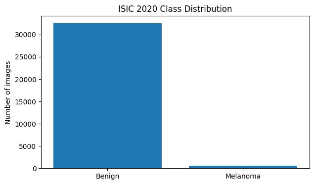

*Figure 1: Class imbalance visualised*

The data has a strong imbalance between benign and melanoma present cases, which provides an avenue for the model to guess benign and have a 98.237% accuracy. This necessitates the uses of PR-AUC as a key performance indicator rather than just plain class accuracy.

### 2.2 Preprocessing: Missing Values and Inconsistent Labelling

Before the data can be used for training, the data must error-checked. An analysis yielded the following:

| Possible Errors                  | \# of cases |
|----------------------------------|-------------|
| image_name                       | 0           |
| patient_id                       | 0           |
| lesion_id                        | 0           |
| sex                              | 65          |
| age_approx                       | 68          |
| anatom_site_general_challenge    | 527         |
| Diagnosis                        | 0           |
| benign_malignant                 | 0           |
| target                           | 0           |
| Patients with both classes       | 427         |
| Lesions with conflicting classes | 0           |
| Duplicate Pairs                  | 425         |

*Table 2: Possible data errors and frequency*

### 2.3 Duplicate Analysis

There are 425 duplicated pairs of data. A further analysis is needed to identify whether images linked as duplicates belong to different patients; they must be assigned to the same split or affected records be removed. This is crucial for a Siamese network as duplicates can enable a model to learn to match identical data rather than checking for markers of melanoma.

The following parameters were investigated:

| Parameter                       | Value |
|---------------------------------|-------|
| Duplicate pairs                 | 425   |
| Pairs with missing metadata     | 0     |
| Pairs across different patients | 0     |
| Pairs across different lesions  | 8     |
| Pairs with conflicting labels   | 0     |

*Table 3: Duplicate analysis across the dataset*

The analysis shows that duplicate pairs are patient-unique, which enables splits based on patient_ids. However, there are pairs across different lesions. This this coudld be due to metadata inconsistencies or different lesion identifiers assigned to duplicate images.

## 3 Data Plan

The completed patient-separated split is shown below. The target proportions were 70% training, 15% validation and 15% test; group separation resulted in the image counts shown.

| Data Type  | Percentage | Number | Melanoma Cases |
|------------|------------|--------|----------------|
| Training   | 70%        | 23,188 | 403            |
| Validation | 15%        | 4,938  | 92             |
| Test       | 15%        | 5,000  | 89             |

*Table 4: Training, validation and test split*

In this dataset, the main leakage risk is that multiple images from the same patient are highly similar. If those images are spread across train, validation and test sets, the model can learn patient-specific patterns instead of true melanoma signals. Grouping by patient_id ensures all images from one patient stay in the same split.

At the same time, melanoma is rare, so a plain group split can easily produce folds with very different melanoma proportions. StratifiedGroupKFold addresses both issues at once: it groups by patient_id to prevent patient overlap, while also stratifying by label to keep the melanoma/benign proportions roughly consistent across folds. The split that best matched the target 70/15/15 distribution and class balance was selected, and patient separation plus class distribution were checked before training.

## 4 Model Plan

The final Siamese model learned representations by comparing pairs of images using a shared ResNet-18 backbone. Each image was mapped to an embedding, and contrastive loss encouraged same-class pairs to have closer embeddings and different-class pairs to have embeddings further apart. An auxiliary classification head was trained jointly with the backbone to predict the class of each image.

Pair sampling increased exposure to melanoma images during Siamese training. The training split contained 403 melanoma images among 23,188 images (1.738%), reduced from 584 among 33,126 images (1.763%) in the full dataset. This severe imbalance motivates deliberate class-aware pair sampling rather than relying on the original image frequencies.

Siamese training used pairs labelled as **same class** or **different classes**. Pair types were balanced across benign–benign, melanoma–melanoma, benign–melanoma and melanoma–benign combinations, excluding images from the same patient within a pair. This increases exposure to the limited melanoma images but did not create new independent melanoma cases or guarantee protection against overfitting. Performance was evaluated on patient-separated validation and test sets.

The auxiliary classification head was trained in conjunction with the contrastive-learning components.Then, at inference, each test image was processed by the trained backbone and auxiliary classification head to produce its melanoma score. The decision threshold was selected using validation data before evaluation on the held-out test set. A validation metric of 80% precision was set as a target.

## 5 GitHub File

### 5.1 Repo Structure

The code structure for the repo is as follows:

```text
recognition/
└── Siamese_Nandos/
    ├── README.md
    ├── dataset.py
    ├── modules.py
    ├── predict.py
    ├── train.py
    ├── train_aux.py
    └── train_baseline.py
```

### 5.2 File Breakdown

| File              | Purpose                                                                                                                                                                                                      |
|-------------------|--------------------------------------------------------------------------------------------------------------------------------------------------------------------------------------------------------------|
| README.md         | Describes the project, how the models work, how to run the code, and the experiments and results.                                                                                                            |
| dataset.py        | Loads the ISIC image data, applies preprocessing and training augmentations, and creates image pairs for Siamese training. It also provides optional RAM caching for resized training and validation images. |
| modules.py        | Defines the ResNet-18 baseline and the Siamese network with an auxiliary classification head, along with the contrastive loss used to train image embeddings.                                                |
| train.py          | Provides one command-line entry point. The selected model determines whether it runs train_baseline.py or train_aux.py.                                                                                      |
| train_baseline.py | Trains the ResNet-18 baseline, evaluates it on the validation split, and saves the best checkpoint and training results.                                                                                     |
| train_aux.py      | Trains the Siamese model using image pairs, contrastive loss and the auxiliary classification head. It also evaluates on the validation split and saves the best checkpoint and training results.            |
| predict.py        | Loads a trained checkpoint, selects a classification threshold using validation data, evaluates the model on the test split, and saves prediction results, metrics and plots.                                |

### 5.3 Architecture Breakdown

The training scripts select the relevant pipeline, while `dataset.py` handles image loading and preprocessing and `modules.py` defines the model architecture. After training, `predict.py` loads the saved checkpoint and applies the same preprocessing to produce test predictions and evaluation outputs.

The dataset, trained checkpoints and generated results are kept outside the source-code folder so the GitHub submission stays focused on the code and documentation.

### 5.4 Software Environment and Dependencies

The dependency pins below match the CPU install in requirements.txt. The saved Colab notebook outputs record PyTorch 2.11.0+cu130 running on GPU hardware, so the notebook training runtime differs from this pinned CPU environment.

| Package      | Pinned version | Use                               |
|--------------|----------------|-----------------------------------|
| Python       | Not pinned     | Notebook runtime                  |
| PyTorch      | 2.11.0+cpu     | Model training and inference      |
| torchvision  | 0.26.0+cpu     | ResNet-18 and image transforms    |
| NumPy        | 2.1.3          | Array and numerical operations    |
| pandas       | 2.2.3          | Split manifests and result tables |
| Pillow       | 11.3.0         | JPEG image loading                |
| scikit-learn | 1.6.1          | Classification metrics            |
| matplotlib   | 3.10.0         | Prediction plots                  |

Python was not pinned in the supplied dependency list. The Colab GPU package build is recorded separately above because it differs from the CPU installation in requirements.txt.

## 6 Baseline Testing

### 6.1 Baseline Model

I used a standard ResNet-18 CNN as the baseline so I had a clear point of comparison for the Siamese model. The task was the same binary classification problem: deciding whether a dermoscopic image is melanoma or benign, using the ISIC 2020 dataset. This setup lets me judge whether the metric-learning approach adds anything over a more conventional supervised model.

The baseline uses **ResNet-18**, a residual CNN that performs well on image data and is easy to adapt with transfer learning. I initialised it with ImageNet-pretrained weights and replaced the final classification layer with a binary output for melanoma likelihood. That lets the model reuse useful visual features instead of learning everything from scratch.

To keep the comparison fair, both models were trained on the same patient-separated training, validation and test splits. The baseline saw 23,188 images, including 403 melanoma cases, which is only 1.738% of the training data. Keeping patient images together reduces the risk of leakage and gives a more realistic estimate of how the model generalises.

The class imbalance is substantial, so I used weighted binary cross-entropy with a positive-class weight of 20 to increase the penalty for missing melanoma cases. This is a practical choice for a dataset where melanoma makes up only about 1.7% of the training set, and it encourages the model to focus more on the rare positive class rather than being dominated by benign examples.

I trained the baseline for 10 epochs on an NVIDIA L4 GPU in Google Colab. Images were resized to 224 × 224 pixels, and validation performance was checked after each epoch. I tracked accuracy, but the main ranking metrics were **average precision (AP)**, AUROC, melanoma precision, recall and F1-score. Those are more informative than raw accuracy in a highly imbalanced problem, especially when the goal is to catch rare malignant cases without creating too many false alarms.

The checkpoint with the highest validation average precision was kept for evaluation. That made the model-selection step depend on performance on unseen validation patients rather than just the training loss. The result is a solid baseline for judging whether the Siamese model provides a meaningful gain over a conventional supervised classifier.

### 6.2 Baseline Training

10 epochs were run of the ResNET-18 and the following plots were generated for analysis between the epochs. See Appendix 1 for full baseline testing data and parameters.

#### 6.2.1 Training and Validation Loss

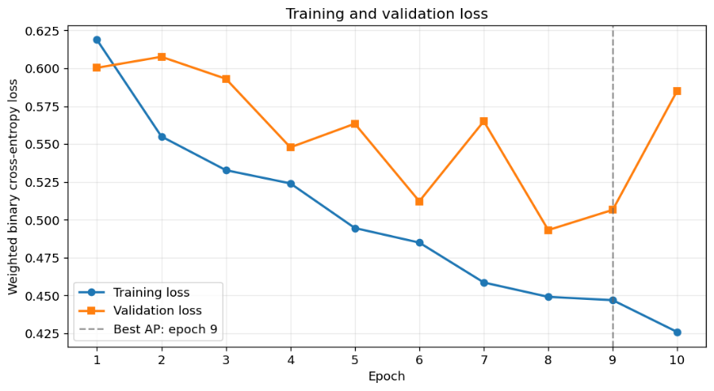

Figure 2 shows that training loss decreased throughout the ten epochs, from 0.6188 to 0.4258. Validation loss generally improved during training but fluctuated between epochs: it reached its lowest value at epoch 8, then increased at epoch 10 even as training loss continued to fall. This late divergence suggests that further fitting to the training data did not consistently improve performance on the validation data. However, the best checkpoint was selected using validation average precision rather than loss.

Figure 2: Training and validation loss for ResNet-18.

#### 6.2.2 Average Precision and AUROC

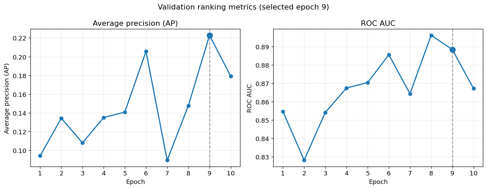

*Figure 3: Average precision and AUROC of ResNet-18 model*

The ranking metrics in Figure 3 show why average precision (AP) was used for checkpoint selection. Validation AP varied substantially, reaching its maximum of 0.2228 at epoch 9 before falling to 0.1793 at epoch 10. AUROC was less variable and reached its maximum of 0.8962 at epoch 8. The two metrics therefore favour different checkpoints: epoch 8 ranked cases well overall by AUROC, while epoch 9 performed best according to AP, which is more informative for identifying the rare melanoma class in this imbalanced dataset.

#### 6.2.3 Melanoma Precision, Recall and F1

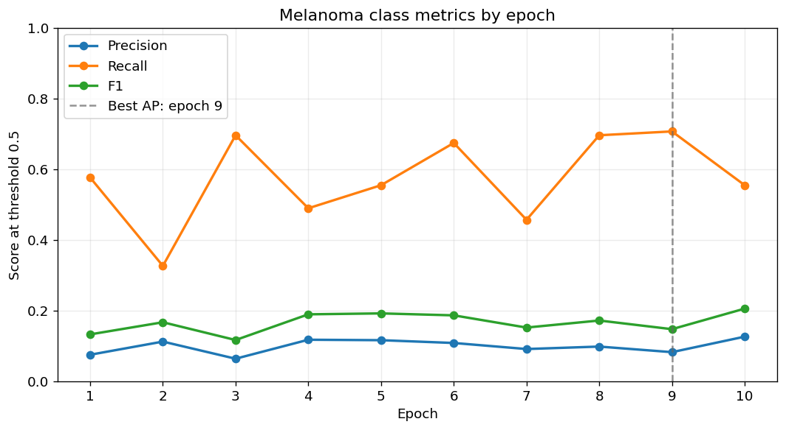

*Figure 4: Melanoma precision, recall and F1 with ResNet-18*

Figure 4 shows that melanoma precision, recall and F1-score also changed considerably across epochs when predictions were made at a threshold of 0.5. Recall ranged from 32.61% to 70.65%, while precision remained low, between 6.35% and 12.59%. At epoch 9, the selected checkpoint had the highest AP and the highest recall, 70.65%, but precision was only 8.21%. The F1-score peaked at epoch 10, at 0.2052, illustrating that the epoch selected by AP does not optimise every class-level measure.

#### 6.2.4 Accuracy and Macro F1

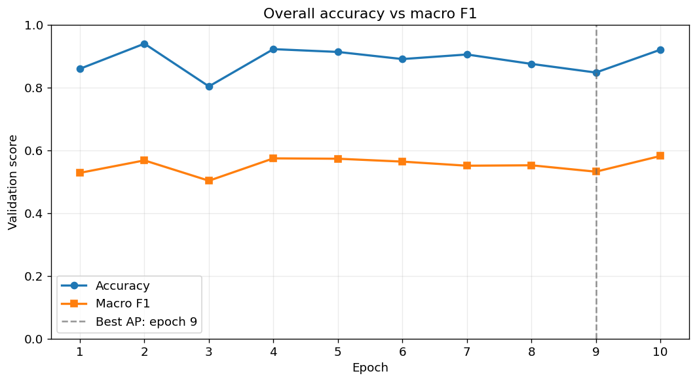

*Figure 5: Accuracy and macro-F1 for ResNet-18*

Figure 5 compares overall accuracy with macro-F1. Accuracy was high in some epochs, reaching 93.92% at epoch 2, but this did not indicate strong melanoma detection: at that epoch, melanoma recall was only 32.61%. Because benign images make up most of the validation set, accuracy is strongly influenced by performance on the benign class. Macro-F1 gives a more balanced view of performance across the two classes; it remained much lower than accuracy, ranging from 0.5028 to 0.5816.

#### 6.2.5 Confusion Matrix Count and Referral Trade-off

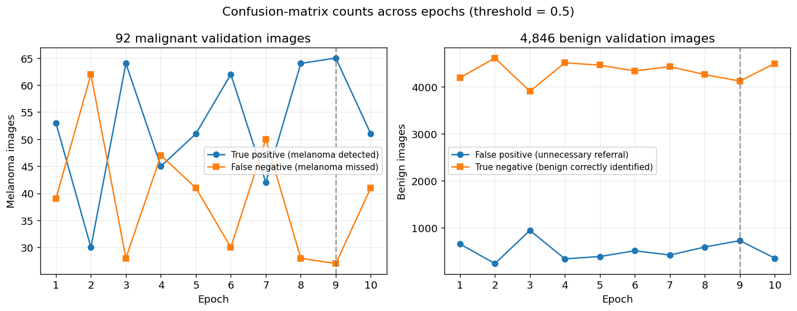

*Figure 6: Confusion matrix counts across epochs*

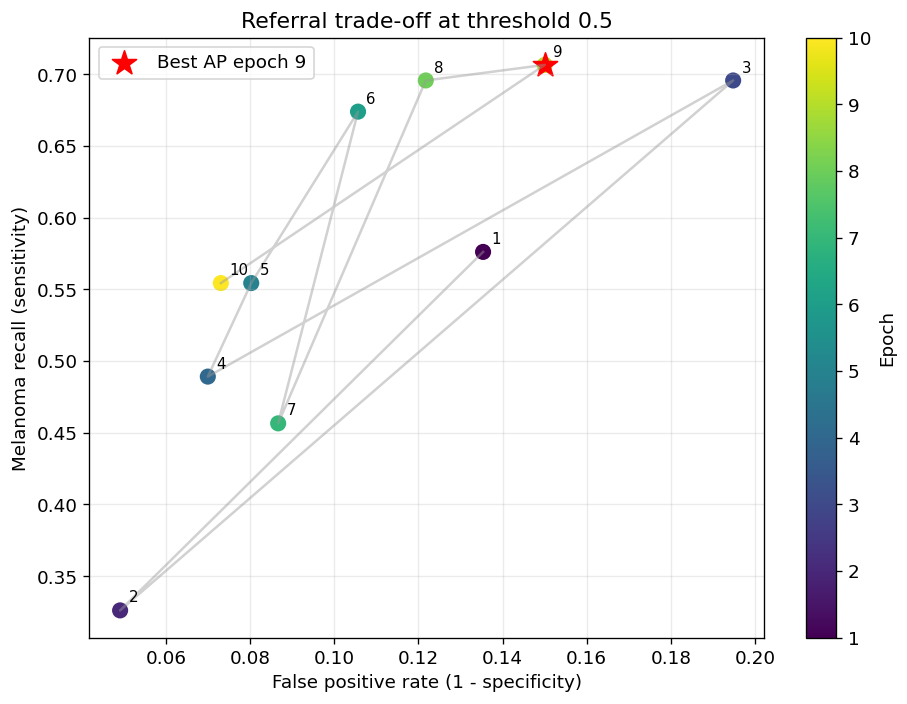

*Figure 7: Melanoma recall vs false-positive rate*

The confusion-count plot in Figure 6 shows how these metrics translate into validation cases. At the selected epoch 9, the model detected 65 of 92 melanomas but missed 27, while also incorrectly flagging 727 benign images. The referral trade-off plot in Figure 7 makes this balance clearer: at the fixed 0.5 threshold, epochs with higher melanoma sensitivity generally also produced more false positives. Overall, the plots show that the baseline learned to distinguish some melanoma cases, but its validation performance was sensitive to the training epoch and operating threshold. Epoch 9 was selected because it achieved the highest validation AP, not because it was best on every metric.

| Field                        | Value              |
|------------------------------|--------------------|
| Row index                    | 0                  |
| model                        | ResNet-18 baseline |
| device                       | NVIDIA L4          |
| test_images                  | 5000               |
| parameters_total             | 11177025           |
| parameters_trainable         | 11177025           |
| parameter_and_buffer_size_MB | 42.6737            |
| peak_GPU_allocated_GB        | 0.3188             |
| peak_GPU_reserved_GB         | 0.4609             |
| model_forward_seconds        | 0.8872             |
| model_forward_ms_per_image   | 0.1774             |
| end_to_end_seconds           | 339.1825           |
| end_to_end_ms_per_image      | 67.8365            |

*Table 5: Hardware performance of ResNet-18 on validation*

## 7 Siamese Model

### 7.1 Experimentation

An earlier contrastive-only Siamese model was evaluated using a prototype-based classifier. A subsequent validation-only experiment tested a class-aware k-nearest-neighbour rule on the frozen epoch-9 embeddings. Its best configuration produced an AP of 0.18357 and an AUROC of 0.76506, compared with 0.18345 and 0.76497 for the prototype method. The small differences did not indicate a meaningful validation improvement, and the k-NN configuration was not evaluated on the test set. These exploratory results were therefore excluded from the final comparison, which uses the later Siamese model with an auxiliary classification head.

### 7.2 Model Setup

The Siamese network was implemented in PyTorch, with ResNet-18 as the shared feature extractor. I initialised it with ImageNet-pretrained weights, matching the baseline setup so it could reuse useful visual features. I replaced the original ResNet-18 classification layer with a projection head that produced 128-dimensional embeddings for similarity learning.

The model processes both images in a pair through the same ResNet-18 backbone. The features then split into two branches: a linear projection that produces 128-dimensional, L2-normalised embeddings for contrastive learning, and an auxiliary linear classifier that predicts the lesion class for each image. That gives the network both a pairwise similarity signal and a direct melanoma/non-melanoma prediction signal.

Each epoch generated 24,000 pairs. I balanced the pair types across benign–benign, melanoma–melanoma, benign–melanoma and melanoma–benign combinations, while excluding any pairs from the same patient. In the notebook sampling check, melanoma images accounted for 50.47% of sampled appearances. With 403 melanoma images in the training split, this works out to roughly 60 sampled appearances per melanoma image per epoch on average. This increased exposure to the available melanoma examples without adding new independent melanoma cases.

The batch size was 64 pairs, or 128 image appearances per batch, which gave 375 optimiser steps per epoch. I trained the model for 12 epochs using AdamW with a learning rate of $1 \times 10^{-4}$ and weight decay of $1 \times 10^{-4}$. The total loss combined contrastive loss and binary cross-entropy classification loss with equal weighting, and the contrastive margin was 1.0. Training images were randomly flipped horizontally and vertically, rotated by up to 15 degrees, and normalised using ImageNet channel statistics.

For validation, I used the auxiliary classifier head to score each image. Average precision and AUROC were computed from the continuous logits, and the checkpoint with the highest validation AP was saved. That was epoch 5, with a validation AP of 0.1979. I then selected the operating threshold separately on the validation data.

### 7.3 Model Training

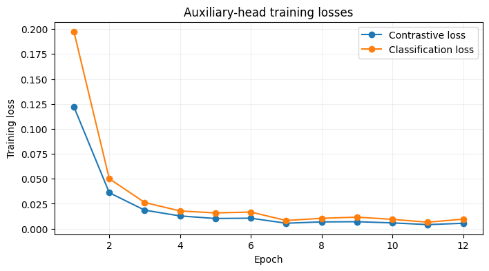

*Figure 8: Auxiliary-head training losses for Siamese model*

The contrastive and classification losses both decreased substantially during training. Total training loss fell from 0.3198 in epoch 1 to 0.0150 in epoch 12, although it reached its lowest value, 0.0106, in epoch 11. This indicates that the model increasingly fitted its training objective, but the validation metrics did not improve steadily. Validation AP reached its highest value of 0.1979 in epoch 5, fell to 0.1278 in epoch 9, and recovered to 0.1904 by epoch 12. AUROC followed a different pattern: it was highest in epoch 1 at 0.8833, fell to 0.7786 in epoch 3, and was 0.8391 in the AP-selected epoch 5. The model was therefore selected by AP rather than AUROC because AP was the chosen checkpoint metric for this imbalanced dataset. The divergence between steadily decreasing training loss and fluctuating validation metrics indicates unstable generalisation and may reflect overfitting, although these curves alone cannot establish its cause. Epoch 5 was retained because it achieved the highest validation AP.

#### 7.3.1 Epoch Data

|     | epoch | train_total_loss | train_contrastive_loss | train_classification_loss | val_ap   | val_auroc | seconds   | peak_gpu_memory_gb |
|-----|-------|------------------|------------------------|---------------------------|----------|-----------|-----------|--------------------|
| 0   | 1     | 0.319752         | 0.122221               | 0.197530                  | 0.174303 | 0.883322  | 24.515279 | 1.815506           |
| 1   | 2     | 0.086187         | 0.036071               | 0.050116                  | 0.179962 | 0.869467  | 23.774871 | 1.797044           |
| 2   | 3     | 0.044831         | 0.018570               | 0.026261                  | 0.161120 | 0.778569  | 23.881832 | 1.797044           |
| 3   | 4     | 0.030574         | 0.012798               | 0.017776                  | 0.172259 | 0.868698  | 23.744870 | 1.797044           |
| 4   | 5     | 0.026037         | 0.010219               | 0.015818                  | 0.197880 | 0.839086  | 23.969150 | 1.797044           |
| 5   | 6     | 0.027177         | 0.010511               | 0.016666                  | 0.163683 | 0.843686  | 23.715839 | 1.797044           |
| 6   | 7     | 0.013704         | 0.005479               | 0.008226                  | 0.168072 | 0.869636  | 23.898763 | 1.797044           |
| 7   | 8     | 0.017224         | 0.006821               | 0.010403                  | 0.160450 | 0.840625  | 23.935144 | 1.797044           |
| 8   | 9     | 0.018582         | 0.007002               | 0.011580                  | 0.127779 | 0.864831  | 24.090767 | 1.797044           |
| 9   | 10    | 0.015198         | 0.005832               | 0.009365                  | 0.176768 | 0.852581  | 23.616481 | 1.797044           |
| 10  | 11    | 0.010607         | 0.004101               | 0.006507                  | 0.160296 | 0.848426  | 23.867814 | 1.797044           |
| 11  | 12    | 0.015027         | 0.005446               | 0.009581                  | 0.190419 | 0.844721  | 24.001358 | 1.797044           |

*Table 6: Metrics for different epochs in the Siamese model*

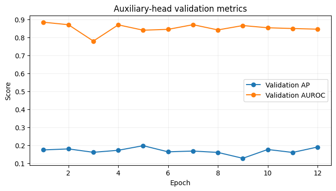

*Figure 9: Auxiliary-head validation metrics*

The validation AP and AUROC vary across epochs rather than improving steadily. AP peaks at 0.1979 in epoch 5, falls to 0.1278 in epoch 9, and recovers to 0.1904 by epoch 12. The peak AP is substantially above the validation melanoma prevalence of 1.86%, indicating that the classifier ranks melanoma cases above benign cases better than a prevalence-level baseline. AUROC follows a different pattern: it is highest in epoch 1 at 0.8833, falls to 0.7786 in epoch 3, and is 0.8391 at the AP-selected epoch 5. Because the checkpoint was selected using AP, epoch 5 was retained even though it did not have the highest AUROC. These metrics use continuous classifier scores, so their values do not depend on the classification threshold. Their fluctuation suggests that validation performance was sensitive to the training epoch.

## 8 Final Testing

### 8.1 Baseline Testing vs Siamese Testing

#### 8.1.1 Confusion Matrices

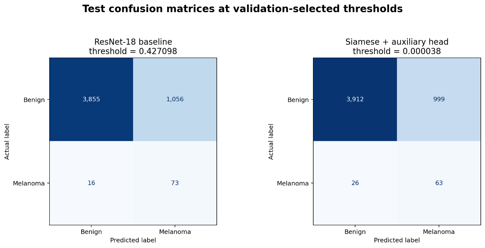

*Figure 10: Confusion matrices for model performance on the test split*

The ResNet baseline correctly identified **73 of 89 melanomas**, missing 16, while producing 1,056 false positives. The Siamese model identified 63 melanomas, missed 26, and produced 999 false positives. Thus, at the selected thresholds, ResNet detected 10 more melanomas but also flagged 57 more benign lesions. Both models generated many false-positive referrals: only about **one in 15–17 flagged cases** was melanoma.

#### 8.1.2 Precision–Recall

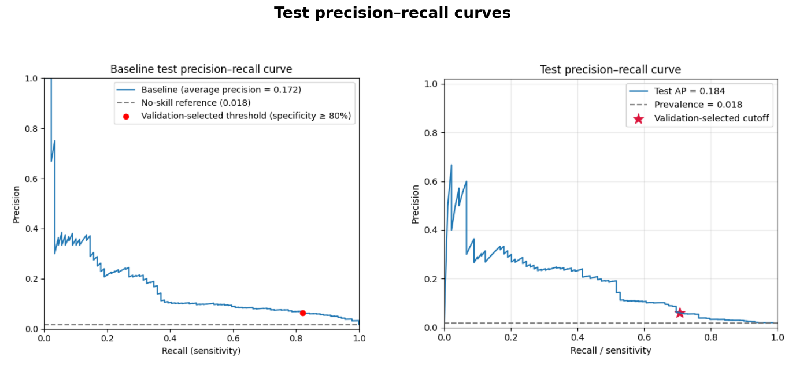

*Figure 11: Precision–recall curves on the test split*

Both curves sit well above the no-skill reference, which is the test-set melanoma prevalence of about **1.78%**. The Siamese model has the higher AP (**0.1842**, compared with **0.1722** for ResNet), indicating a modestly stronger precision–recall summary across thresholds. At the selected operating points, however, ResNet has higher recall (**0.8202 vs 0.7079**) and slightly higher precision (**0.0647 vs 0.0593**). The curves therefore show a trade-off: the Siamese model’s overall AP is higher, but ResNet’s chosen threshold catches more melanomas.

#### 8.1.3 ROC

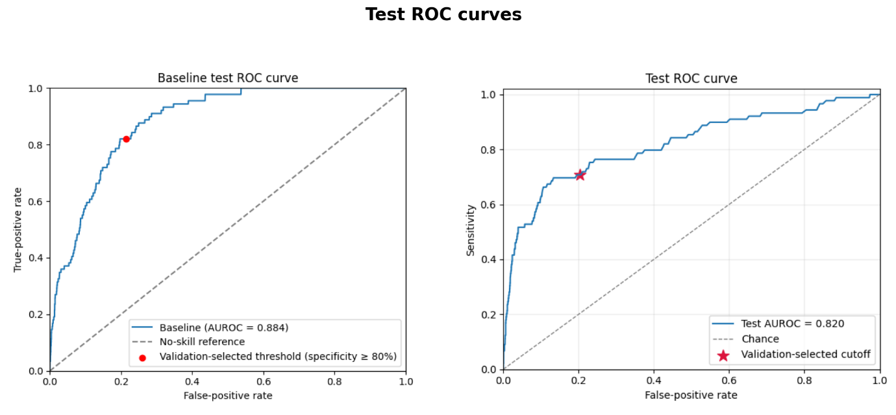

*Figure 12: ROC curves on the test split*

ResNet has the higher AUROC (**0.8836 vs 0.8195**), so it ranks positive cases above negative cases more effectively overall according to this measure. At the selected operating points, ResNet reaches a true-positive rate of 0.8202 with a false-positive rate of 0.2150. Siamese has a slightly lower false-positive rate of 0.2034, but its true-positive rate is also lower at 0.7079. This is consistent with the confusion matrices: Siamese makes fewer false-positive referrals, while ResNet detects more melanoma cases.

#### 8.1.4 Prediction Score Distribution

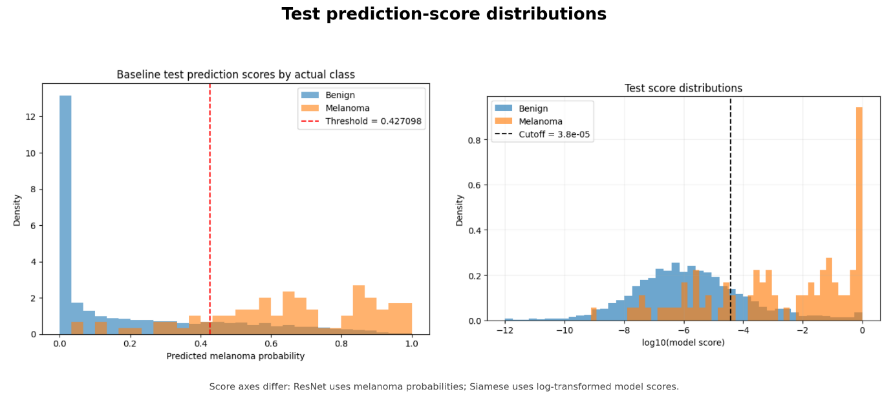

*Figure 13: Prediction score distributions on the test split*

For both models, melanoma scores tend to be higher than benign scores, but the distributions overlap. That overlap helps explain why both models produce many false positives while still missing melanomas. Read these plots qualitatively: the ResNet scores are probabilities, while the Siamese scores are log-transformed model scores. Their horizontal scales and threshold values are different, so the score magnitudes should not be compared directly.

#### 8.1.5 Overall Comparison

Both thresholds below were selected on the validation set using the same rule: **maximise sensitivity while maintaining at least 80% specificity**. Test specificity is below 80% for both models; that is the measured result on the held-out test set.

**Prediction reproducibility:** for both models, append --threshold-policy val_specificity80_max_sensitivity to the existing predict.py command, retaining the same checkpoint, validation/test splits and other run settings. This explicitly selects the policy used in the report: maximise validation sensitivity subject to at least 80% validation specificity, then apply the selected threshold unchanged to the test set. The policy alone cannot guarantee identical numerical thresholds without the original checkpoint, data and preprocessing. The README prediction examples and any default-policy documentation must use this explicit option. Source-code and README updates remain pending access to those files.

| **Metric**                    | **ResNet-18 baseline** | **Siamese + auxiliary head** |
|-------------------------------|------------------------|------------------------------|
| Validation-selected threshold | 0.427098               | 0.000038                     |
| Test AP                       | 0.1722                 | 0.1842                       |
| Test AUROC                    | 0.8836                 | 0.8195                       |
| Specificity                   | 0.7850                 | 0.7966                       |
| TP                            | 73                     | 63                           |
| FP                            | 1,056                  | 999                          |
| FN                            | 16                     | 26                           |
| TN                            | 3,855                  | 3,912                        |

*Table 7: Validation-selected thresholds, test ranking metrics and confusion counts*

| Model                    | Accuracy | Benign precision | Benign recall | Benign F1 |
|--------------------------|----------|------------------|---------------|-----------|
| ResNet-18 baseline       | 0.7856   | 0.9959           | 0.7850        | 0.8779    |
| Siamese + auxiliary head | 0.7950   | 0.9934           | 0.7966        | 0.8842    |

*Table 8: Test accuracy and benign-class performance*

| Model                    | Melanoma precision | Melanoma recall | Melanoma F1 | Macro-F1   |
|--------------------------|--------------------|-----------------|-------------|------------|
| ResNet-18 baseline       | 0.0647             | 0.8202          | 0.1199      | **0.4989** |
| Siamese + auxiliary head | 0.0593             | 0.7079          | 0.1095      | **0.4968** |

*Table 9: Test melanoma-class performance and macro-F1*

Overall, neither model performs best on every measure. ResNet has higher recall and AUROC; Siamese has slightly higher AP and specificity, with fewer false positives. The numerical thresholds themselves are on different score scales and should not be compared as though they were equivalent.

### 8.2 Failure Autopsies

To further examine model performance, the failure modes of each model must be identified. The most critical failure in this context is a false negative, where a model identifies a lesion as benign when it is malignant.

The following table contains images that were misclassified by both models as well as an error each that was model unique:

| | |
|---|---|
| 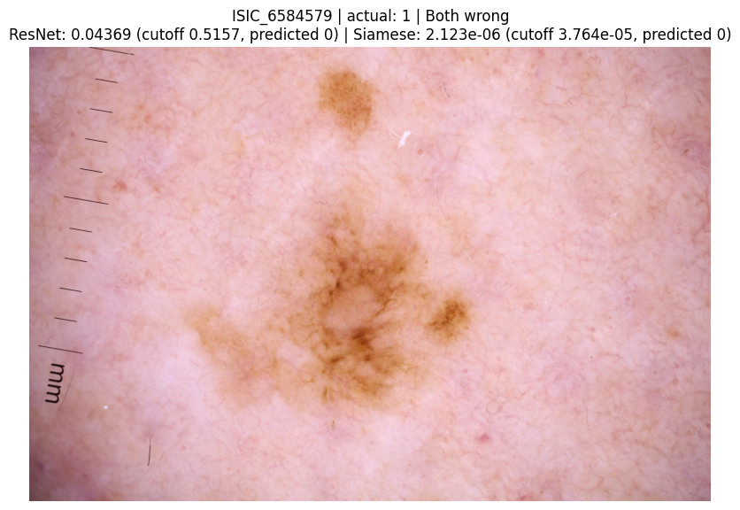 | 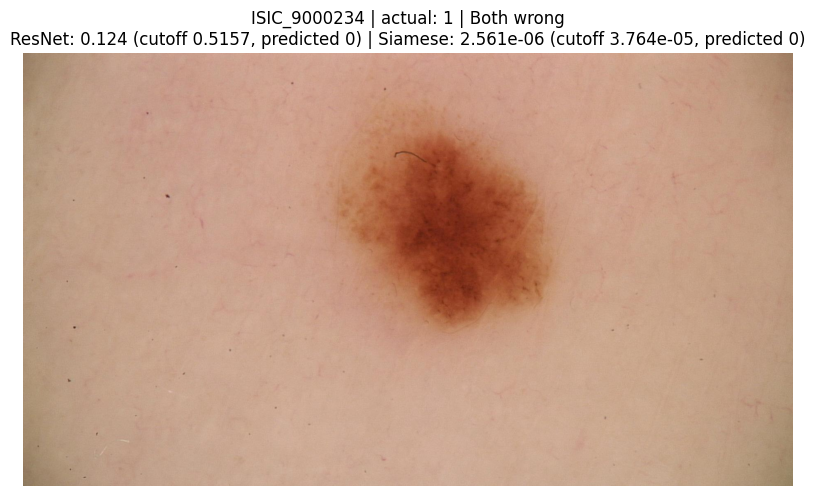 |
| 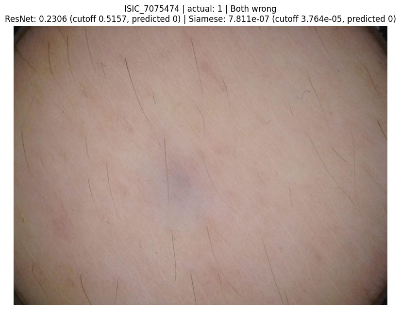 | 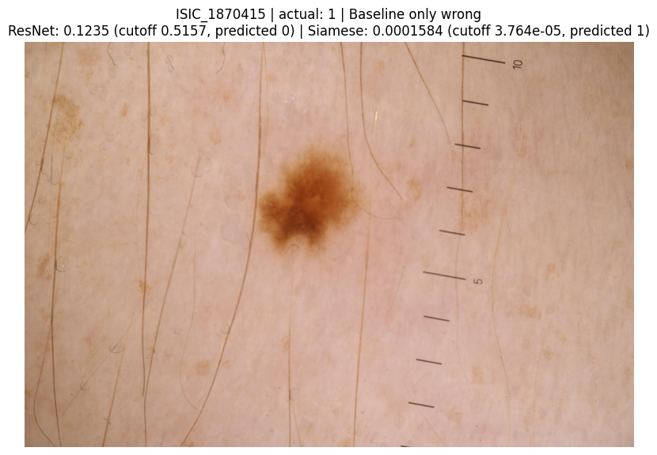 |
| 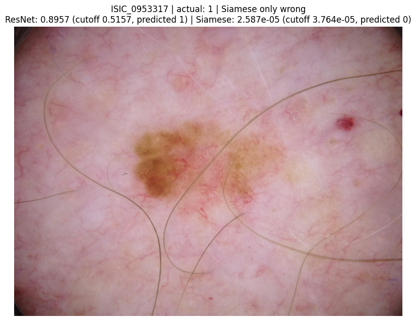 | 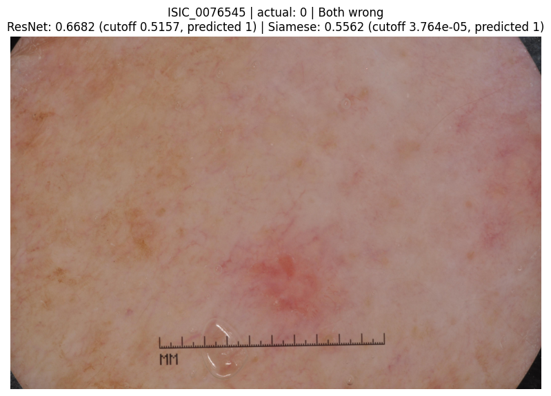 |
| 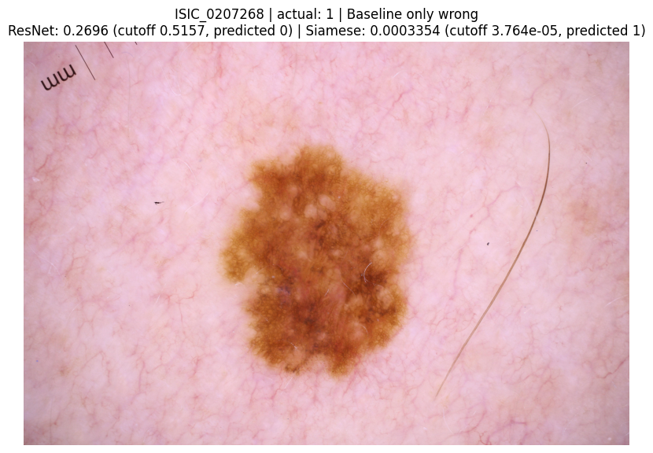 | |

*Table 10: Failure autopsies of both models*

The selected cases illustrate both shared errors and differences between the models. Predictions were assessed at thresholds chosen using the validation set: 0.427098 for ResNet and approximately 0.000038 for the Siamese model. The cases come from the held-out test set, so they show how the models performed on images not used for training or threshold selection.

Both models produced a false positive for **ISIC_0076545**, which was labelled benign. Its ResNet score was 0.6682, above the ResNet threshold, and its Siamese score was 0.5562, above the Siamese threshold. This shared error shows that both models can assign a melanoma prediction to a benign lesion. Such false positives may lead to unnecessary referrals for expert review. This is relevant to the test results, where both models produced many false positives: 1,056 for ResNet and 999 for Siamese.

The models differed on **ISIC_0207268**, a melanoma case that ResNet missed. Its ResNet score of 0.2696 fell below the ResNet threshold, while the Siamese score of 0.000335 exceeded the Siamese threshold, so the Siamese model correctly classified it. Conversely, for **ISIC_0953317**, ResNet correctly classified the melanoma, but the Siamese score fell below its threshold and the case was missed. These examples show that the models make different errors on some individual lesions, but a few cases alone cannot establish that one model is consistently better.

Both models also missed **ISIC_6584579**, another melanoma case. Its score was below each model’s threshold, so neither system flagged it for review. This shared false negative is particularly important because missed melanoma cases are a key risk in a screening or triage setting.

Overall, the examples reflect the trade-off shown in the test results. ResNet achieved higher melanoma recall (0.8202 compared with 0.7079 for Siamese), while the Siamese model had slightly higher specificity (0.7966 compared with 0.7850). The images provide examples of how these errors occur, while the aggregate metrics provide the stronger basis for comparing model performance. The scores should be interpreted relative to each model’s own threshold; their numerical scales are different and should not be compared directly.

## 9 Conclusion

This project compared a ResNet-18 baseline with a Siamese network that used an auxiliary classification head for binary melanoma classification on the ISIC 2020 dataset. I kept patient-level separation between the training, validation and test sets to reduce leakage.

On the held-out test set, the Siamese model achieved a slightly higher average precision than ResNet (0.1842 vs 0.1722), while ResNet had higher AUROC (0.8836 vs 0.8195) and melanoma recall (0.8202 vs 0.7079). At their validation-selected thresholds, ResNet detected 73 of 89 melanomas and the Siamese model detected 63; both models also produced many false positives. Neither model met the validation target of at least 80% specificity on the test set, which shows the chosen operating points did not transfer perfectly to unseen data.

Overall, both models learned useful ranking information, but neither is suitable for autonomous diagnosis or for ruling out melanoma. The Siamese model’s small gains in AP and specificity were not enough to outweigh its lower recall in this evaluation, and the results do not show that the added complexity provides a clear operational advantage. I would treat both systems as research prototypes for human-reviewed triage only. Before they are considered for any clinical use, they would need broader external validation, calibrated operating thresholds or reject options, subgroup evaluation and measured resource profiling. The current evidence supports continued investigation rather than clinical deployment.

The current study used a fixed training configuration rather than a formal hyperparameter sweep, but the results suggest that performance is sensitive to several choices, including the positive-class weight, learning rate, weight decay, batch size, contrastive margin and augmentation policy. That makes tuning difficult in this setting because the dataset contains relatively few melanoma examples: only 403 melanoma cases in the training split and 89 in the test split. With such a small positive class, optimisation can easily overfit to the limited data and produce unstable validation estimates.

A more systematic search would therefore need to use nested, patient-grouped validation splits and optimise clinically relevant metrics such as AP and sensitivity at fixed specificity, rather than raw accuracy. Future work could explore these settings more formally, but the small sample size makes broad tuning unreliable unless it is tightly constrained and validated carefully.

### 9.1 AI Disclosure Statement

ChatGPT was used to clarify model and evaluation concepts, assist with debugging and drafting evaluation code, and help prepare report documentation. The Colab notebooks were run to produce the reported training and test outputs, and the results were checked against the saved notebook outputs and report tables. The student remains responsible for reviewing the code, verifying the calculations and ensuring that the final committed implementation matches the experiments.

## 10 References

Australian Institute of Health and Welfare. (2026). *Melanoma of the skin in Australia*. Cancer data in Australia. Updated 14 July 2026. [Melanoma of the skin in Australia](https://www.aihw.gov.au/reports/cancer/cancer-data-in-australia/contents/cancer-data-commentaries/melanoma-of-the-skin-in-australia). Accessed 30 October 2026.

Cancer Council Australia. (n.d.-a). *UV radiation: Early detection of skin cancer*. [Early detection of skin cancer position statement](https://www.cancer.org.au/about-us/policy-and-advocacy/prevention/uv-radiation/related-resources/early-detection-of-skin-cancer). Accessed 30 October 2026.

Cancer Council Australia. (n.d.-b). *Detection and screening*. [Detection and screening](https://www.cancer.org.au/about-us/policy-and-advocacy/prevention/uv-radiation/related-resources/detection-and-screening). Accessed 30 October 2026.

## 11 Appendix

### 11.1 Appendix 1: Full Baseline Training Data

**All epochs (validation): losses, overall metrics and runtime**

| epoch | train_loss | val_loss | pr_auc_ap | roc_auc | accuracy | macro_f1 | minutes |
|-------|------------|----------|-----------|---------|----------|----------|---------|
| 1     | 0.6188     | 0.6003   | 0.0941    | 0.8547  | 0.8593   | 0.5279   | 35.1250 |
| 2     | 0.5550     | 0.6076   | 0.1343    | 0.8282  | 0.9392   | 0.5676   | 35.7283 |
| 3     | 0.5327     | 0.5931   | 0.1079    | 0.8542  | 0.8032   | 0.5028   | 35.5817 |
| 4     | 0.5240     | 0.5478   | 0.1350    | 0.8675  | 0.9218   | 0.5740   | 33.5383 |
| 5     | 0.4945     | 0.5634   | 0.1408    | 0.8705  | 0.9129   | 0.5729   | 35.1983 |
| 6     | 0.4849     | 0.5122   | 0.2057    | 0.8856  | 0.8902   | 0.5637   | 33.3917 |
| 7     | 0.4585     | 0.5650   | 0.0894    | 0.8644  | 0.9048   | 0.5506   | 35.7833 |
| 8     | 0.4490     | 0.4932   | 0.1475    | 0.8962  | 0.8748   | 0.5519   | 35.2017 |
| 9     | 0.4469     | 0.5065   | 0.2228    | 0.8885  | 0.8473   | 0.5316   | 35.4400 |
| 10    | 0.4258     | 0.5852   | 0.1793    | 0.8673  | 0.9200   | 0.5816   | 35.3200 |

**All epochs (validation): melanoma metrics and case counts**

| epoch | melanoma_precision | melanoma_recall | melanoma_f1 | specificity | tp  | fp  | fn  | tn   | referrals |
|-------|--------------------|-----------------|-------------|-------------|-----|-----|-----|------|-----------|
| 1     | 0.0748             | 0.5761          | 0.1323      | 0.8646      | 53  | 656 | 39  | 4190 | 709       |
| 2     | 0.1119             | 0.3261          | 0.1667      | 0.9509      | 30  | 238 | 62  | 4608 | 268       |
| 3     | 0.0635             | 0.6957          | 0.1164      | 0.8052      | 64  | 944 | 28  | 3902 | 1008      |
| 4     | 0.1172             | 0.4891          | 0.1891      | 0.9300      | 45  | 339 | 47  | 4507 | 384       |
| 5     | 0.1159             | 0.5543          | 0.1917      | 0.9197      | 51  | 389 | 41  | 4457 | 440       |
| 6     | 0.1080             | 0.6739          | 0.1862      | 0.8943      | 62  | 512 | 30  | 4334 | 574       |
| 7     | 0.0909             | 0.4565          | 0.1516      | 0.9133      | 42  | 420 | 50  | 4426 | 462       |
| 8     | 0.0979             | 0.6957          | 0.1716      | 0.8783      | 64  | 590 | 28  | 4256 | 654       |
| 9     | 0.0821             | 0.7065          | 0.1471      | 0.8500      | 65  | 727 | 27  | 4119 | 792       |
| 10    | 0.1259             | 0.5543          | 0.2052      | 0.9270      | 51  | 354 | 41  | 4492 | 405       |

### 11.2 Appendix 2: Compute Time for Baseline Epochs

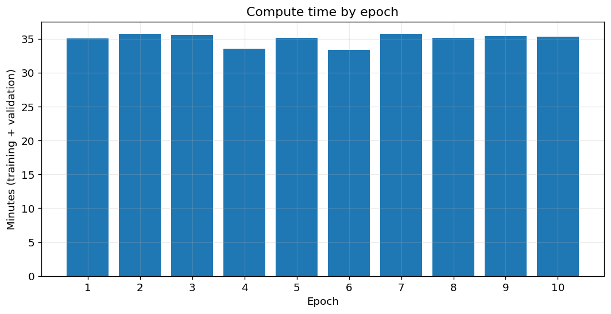
